<p align="center">
  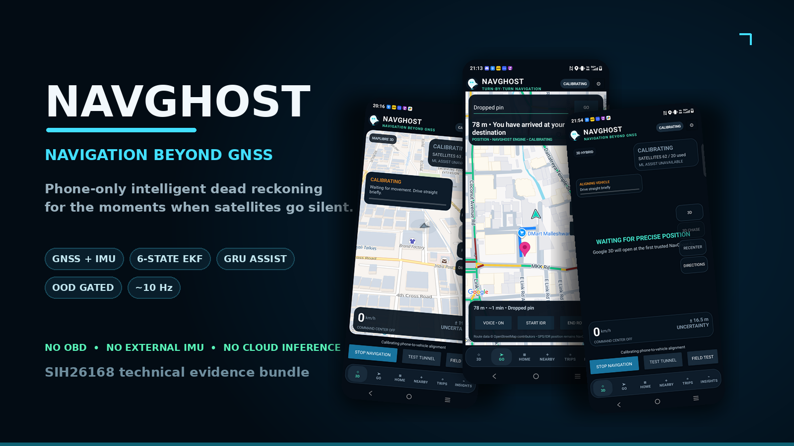
</p>

<p align="center">
  <a href="https://navghost-idr.vercel.app/"></a>
  <a href="https://navghost-idr.vercel.app/downloads/NavGhost-Android-v2.4.0.apk"></a>
  <a href="https://youtube.com/shorts/dDlNKvobRqo?si=_gFi8ewl1akC1nOQ"></a>
</p>

<p align="center"><strong>Phone-only intelligent dead reckoning for the moments when satellites go silent.</strong></p>

<p align="center">
  
  
  
  
  
  
</p>

<p align="center">
  <kbd><a href="#the-navigation-stack">Architecture</a></kbd>
  <kbd><a href="#october-metro-failure--engineering-repair">Field repair</a></kbd>
  <kbd><a href="#experience-across-three-map-worlds">Experience</a></kbd>
  <kbd><a href="#play-signal-survival">Play</a></kbd>
  <kbd><a href="#measurednot-mythologized">Evidence</a></kbd>
  <kbd><a href="#install-and-explore">Install</a></kbd>
</p>

<p align="center">
  
</p>

<p align="center"><sub>Animated conceptual state journey · measured evidence is reported separately below</sub></p>

## Play Signal Survival

<p align="center">
  <a href="https://navghost-idr.vercel.app/simulator/">
    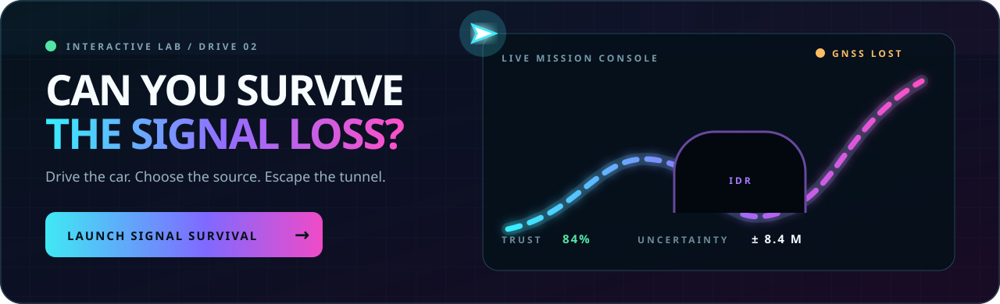
  </a>
</p>

<p align="center">
  <a href="https://navghost-idr.vercel.app/simulator/"></a>
  
  
</p>

Drive the car yourself with **WASD, arrow keys, or touch controls**. Follow the live minimap into a GNSS-denied metro tunnel, choose between a stale satellite fix and NavGhost's guarded IDR, survive the underground fork, and watch the engine verify fresh fixes after resurfacing. The mission reacts with live **speed**, **uncertainty**, **position source**, and **trust** telemetry before grading the run.

> **Technical honesty:** Signal Survival is an educational, conceptual simulation—not a benchmark run. Measured results remain in the evidence sections below.

<details>
<summary><strong>No browser game? Play the README-native version</strong></summary>

### Event 1 — satellite count looks healthy, but the physical fix is stale

- **A.** Keep drawing the old GNSS dot because it looks precise.
- **B.** Reject the stale fix and arm IDR from the last trusted state.

<details><summary>Reveal the engine decision</summary>

**B.** Freshness—not the number of visible satellites—determines whether GNSS may retain authority.

</details>

### Event 2 — the metro stops while IMU bias still resembles acceleration

- **A.** Integrate indefinitely.
- **B.** Apply a zero-velocity constraint only when stationary evidence is strong.

<details><summary>Reveal the engine decision</summary>

**B.** A guarded stationary constraint prevents false velocity from becoming kilometres of downstream position drift.

</details>

### Event 3 — one fresh GNSS fix returns far from the estimate

- **A.** Teleport to it immediately.
- **B.** Require a distinct, mutually consistent fix streak before bounded recovery.

<details><summary>Reveal the engine decision</summary>

**B.** NavGhost verifies recovery before returning authority; one attractive fix is not enough.

</details>
</details>

---

## When the sky disappears, navigation should not

GNSS works beautifully—until a vehicle enters a tunnel, underground metro, dense urban canyon, parking structure, or interference zone.

**NavGhost bridges that gap.** It starts from the last trusted satellite fix, reads the phone's inertial sensors, propagates motion through a physics-first estimator, admits ML assistance only when the input is familiar, grows uncertainty honestly, and verifies GNSS before returning control.

> NavGhost does not predict where a vehicle *should* be. It estimates where the vehicle *might* be—and tells you when that estimate is no longer trustworthy.

Built by **Team NET-PSYCHO** for **Smart India Hackathon 2026 · SIH26168**, based on the Intelligent Dead Reckoning problem statement from ISRO / Department of Space.

## At a glance

| | Current verified status |
|---|---|
| **Release** | NavGhost `2.4.0` · Android `versionCode 41` |
| **Runtime** | Phone GNSS + IMU · on-device · approximately 10 Hz normalized engine stream |
| **Estimator** | 6-state EKF with stationary constraints and uncertainty propagation |
| **ML assistant** | 1-layer, 32-unit GRU · 4,257 parameters · OOD gated |
| **Frozen benchmark** | **3 of 4** locked GNSS-outage windows below 10% drift |
| **Engineering gate** | **311 Python + 207 Kotlin tests**, Android lint, debug and signed-release builds |
| **Physical smoke test** | vivo V2513 / Android 16 · data-preserving install · three map renderers · no observed NavGhost crash/ANR |
| **Honest boundary** | 120-second frozen result is **11.692%**; repeat moving metro validation is still required |

<p align="center">
  <a href="technical-evidence/field-failure-20261010/FIELD_FAILURE_REPAIR_REPORT.md"><strong>Latest field-failure report</strong></a>
  &nbsp;·&nbsp;
  <a href="technical-evidence/accuracy-attack-20261007/NAVGHOST_120_SECOND_FINAL_ATTACK_REPORT.md"><strong>Accuracy report</strong></a>
  &nbsp;·&nbsp;
  <a href="SIH26168_JUDGE_EVIDENCE.md"><strong>Judge evidence</strong></a>
</p>

### Choose your route

| 90-second overview | Technical deep dive | Reproduce the research | Try the app |
|:---:|:---:|:---:|:---:|
| [Judge evidence](SIH26168_JUDGE_EVIDENCE.md) | [System overview](technical-evidence/docs/FINAL_TECHNICAL_OVERVIEW.md) | [Research guide](research/README.md) | [Android download](https://navghost-idr.vercel.app/downloads/NavGhost-Android-v2.4.0.apk) |

---

## The navigation stack

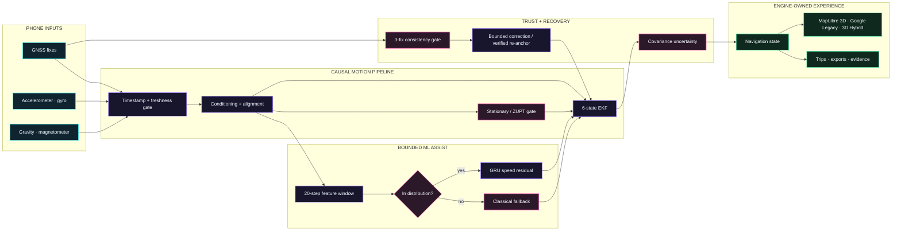

The authority boundary is intentionally simple:

```text
PHONE SENSORS  ──▶  NAVGHOST ENGINE  ──▶  NAVIGATION STATE  ──▶  MAPS + UI
                         ▲
                   truth lives here
```

Maps render the engine-owned position. They cannot inject a prettier location back into the estimator.

### Trust state machine

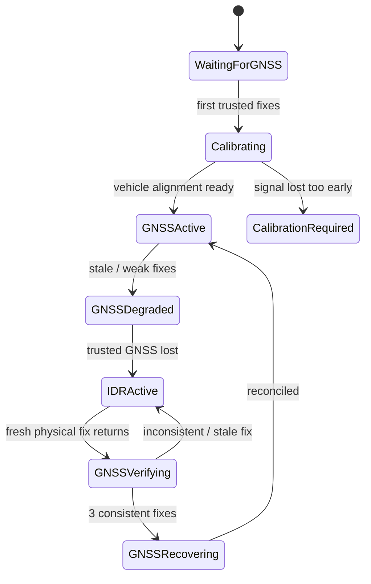

### One outage, frame by frame

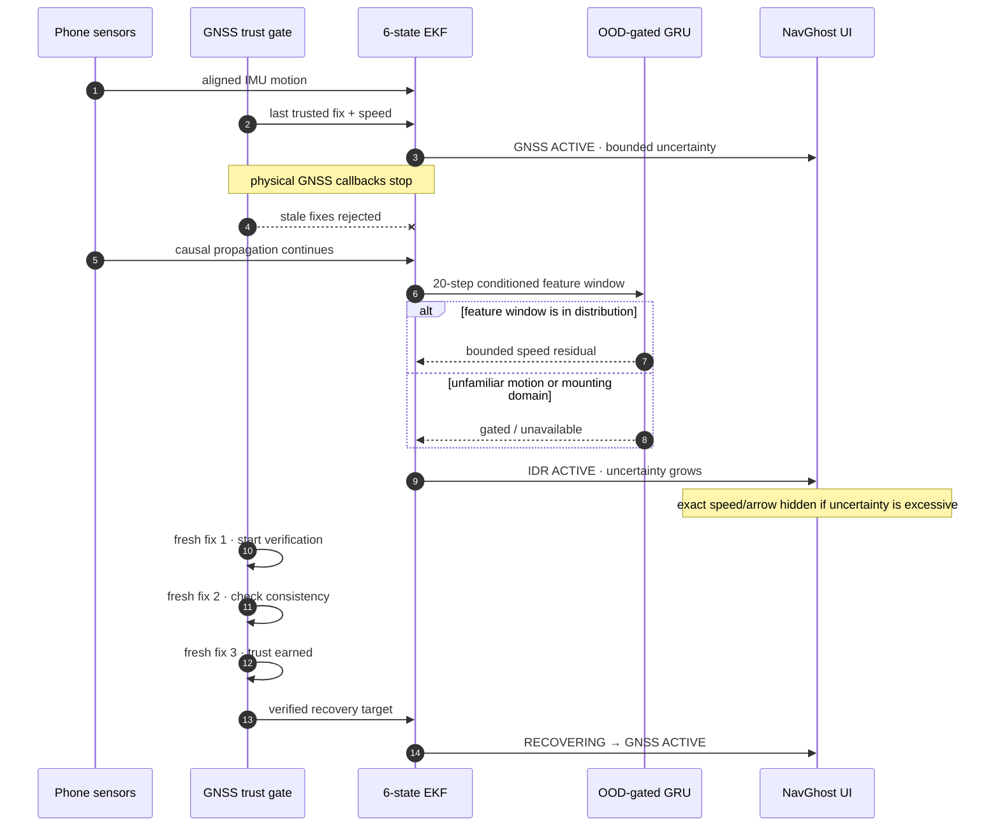

<details>
<summary><strong>What happens during a GNSS outage?</strong></summary>

1. GNSS freshness—not satellite count—decides whether a fix is usable.
2. The last trusted position, speed, heading and covariance seed the outage.
3. Conditioned phone motion propagates the six-state EKF causally.
4. The stationary gate can apply a zero-velocity constraint when supported by evidence.
5. The GRU may contribute a bounded speed residual only inside its learned domain.
6. Uncertainty expands; exact speed and the precise map arrow disappear when confidence becomes indefensible.
7. Returning GNSS must form a distinct, mutually consistent three-fix streak before recovery.

</details>

---

## Built to fail honestly

| Guardrail | Why it exists |
|---|---|
| **Freshness and identity checks** | Duplicate, stale, or evaluator-only fixes cannot masquerade as live navigation input. |
| **Causal processing** | Runtime code never uses future samples or offline reference labels. |
| **Physics-first authority** | The EKF remains authoritative; ML predicts only a bounded speed residual. |
| **OOD rejection** | Unfamiliar sensor windows reduce or disable ML assistance. |
| **Speed envelope** | Unobserved acceleration cannot grow forever during a long outage. |
| **Uncertainty-aware UI** | NavGhost stops showing exact speed at high uncertainty and removes the precise arrow when position is unavailable. |
| **Verified reacquisition** | One attractive GNSS fix cannot teleport the estimator after kilometres of drift. |
| **Map isolation** | Map imagery and route graphics never become hidden localization measurements. |

## October metro failure → engineering repair

The supplied Bengaluru Metro recording and exported session exposed a connected failure chain:

```mermaid
flowchart LR
    A[GNSS callback gap<br/>490.993 s] --> B[Biased acceleration]
    B --> C[Old speed ceiling<br/>120.97 km/h]
    C --> D[False motion through stops]
    D --> E[Position + uncertainty drift]
    E --> F[Returned GNSS corrected<br/>too slowly]

    F --> G[Three-fix verification]:::fix
    G --> H[Verified large-drift re-anchor]:::fix

    classDef fix fill:#10291f,stroke:#52e5a5,color:#f4fbff,stroke-width:2px
```

| Observed failure | Repair in the current candidate |
|---|---|
| Speed locked near **121 km/h** through real station stops | Reduced unobserved speed-growth allowance and ceiling; exact replay no longer reaches the reproduced 33.60 m/s plateau |
| Multi-kilometre estimate presented like a precise position | High-uncertainty speed suppression and map-marker removal |
| Credible GNSS returned but recovery remained slow | Three consistent fixes can re-anchor a long, high-uncertainty, large-innovation state |
| One inconsistent fix could inherit earlier trust | Inconsistent callbacks restart the verification streak |
| Absolute heading could perturb a correlated denied-position state | Heading correction is deferred until the verified recovery path |

**Replay result:** journey-bounded maximum fell from the reproduced **120.97 km/h ceiling** to **85.75 km/h**. This removes the confirmed runaway ceiling; it does **not** prove exact speed at every underground station. A quiet phone IMU cannot independently distinguish perfectly smooth motion from rest.

<p align="center">
  <a href="technical-evidence/field-failure-20261010/FIELD_FAILURE_BASELINE.md">Forensic baseline</a>
  &nbsp;·&nbsp;
  <a href="technical-evidence/field-failure-20261010/FIELD_FAILURE_REPAIR_REPORT.md">Repair report</a>
  &nbsp;·&nbsp;
  <a href="technical-evidence/field-failure-20261010/DEVICE_VALIDATION_REPORT.md">Device validation</a>
  &nbsp;·&nbsp;
  <a href="technical-evidence/field-failure-20261010/METRO_FIELD_TEST_CHECKLIST.md">Repeat-test protocol</a>
</p>

---

## Experience across three map worlds

<table>
  <tr>
    <td width="33%" align="center">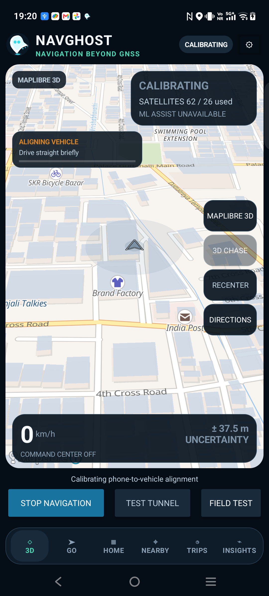<br/><strong>MapLibre 3D</strong></td>
    <td width="33%" align="center">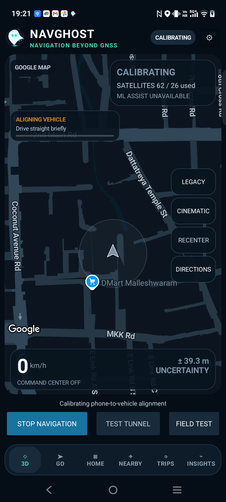<br/><strong>Google Legacy</strong></td>
    <td width="33%" align="center">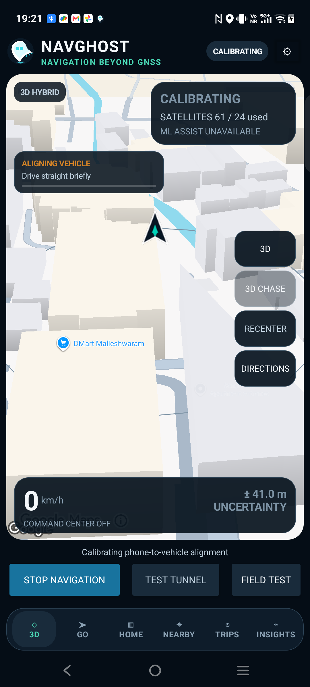<br/><strong>Google 3D Hybrid</strong></td>
  </tr>
</table>

All three renderers displayed the same physical engine fix during the October 10 device smoke test. Manual dragging remained under user control, and the explicit **RECENTER** action returned to the live marker.

<details>
<summary><strong>See manual follow/recenter evidence</strong></summary>

<table>
  <tr>
    <td width="50%" align="center">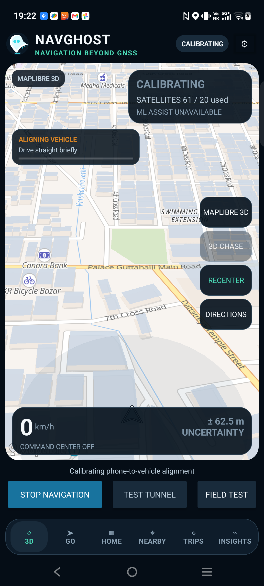<br/><strong>User-controlled map</strong></td>
    <td width="50%" align="center">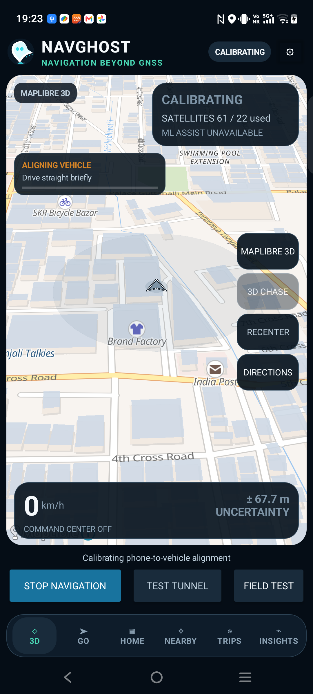<br/><strong>Explicit recenter</strong></td>
  </tr>
</table>

</details>

---

## Measured—not mythologized

### Frozen locked-window result

| GNSS denial window | Drift | Under 10% gate |
|---:|---:|:---:|
| 10 s | **8.503%** | ✅ |
| 30 s | **2.834%** | ✅ |
| 60 s | **3.765%** | ✅ |
| 120 s | **11.692%** | ❌ |

**Result: 3/4.** A road-assisted experiment reached 9.952% at 120 seconds but regressed the 30-second turning window to 19.782%, so it was rejected rather than deployed.

### Verification matrix

| Layer | Result |
|---|---:|
| Python research/evaluation suite | **311 passed** |
| Kotlin/Android JVM suite | **207 passed** |
| Exact exported-session replay | **Passed** |
| Android lint | **Passed** |
| Debug + signed release assembly | **Passed** |
| Physical data-preserving install | **Passed** |
| Short physical GNSS + map smoke test | **Passed** |
| Repeat moving metro validation | **Required** |

The frozen GRU remains unchanged:

```text
SHA-256  fa2169781f9e499dd87fdd00038a3b4a1326181b31938cec237a7802ae0bb4ec
```

<details>
<summary><strong>Compact ML model card</strong></summary>

| Property | Frozen configuration |
|---|---:|
| Architecture | 1-layer GRU + bounded linear residual head |
| Input / hidden / output | 10 / 32 / 1 |
| Sequence | 20 steps · 2.0 seconds · nominal 10 Hz |
| Parameters | **4,257** |
| Checkpoint size | **21,649 bytes** |
| Training / validation windows | 11,818 / 3,489 |
| Loss / optimizer | Huber / Adam |
| Batch / learning rate | 128 / 0.002 |
| Output authority | Speed residual only—never latitude or longitude |

[Open the complete model card](technical-evidence/models/model_card.md)

</details>

---

## Install and explore

### Protected demonstration release

[**Download NavGhost 2.4.0 for Android**](https://navghost-idr.vercel.app/downloads/NavGhost-Android-v2.4.0.apk)

- Android 8.0 / API 26 or newer
- Core localization is on-device and does not require an account or cloud inference
- SHA-256: `cc1066ae3ba073fe657564624b2152ba67a3812eb5dcc4b4ac50bfa5808ff1fd`

### Controlled-test recovery candidate

[**Download the signed October 10 recovery candidate**](technical-evidence/field-failure-20261010/NavGhost-2.4.0-field-recovery-candidate-release.apk)

- Same application identity and signing certificate as the installed 2.4.0 lineage
- Passed stationary physical-device smoke testing
- Requires a repeat controlled metro journey before promotion to the public download
- SHA-256: `00ff90ac028188ef41214e0f876ad2baafa204857bd591071ad74dcd61a7aeeb`

> Mount the phone securely and configure the test while parked. Never operate the app while driving. NavGhost is a research prototype, not safety-certified navigation.

---

## Repository guide

```text
SIH26168-IDR/
├── technical-evidence/
│   ├── android/android/             # Kotlin runtime + tests
│   ├── training/                    # Model training and preprocessing
│   ├── models/                      # Frozen GRU, scaler and model card
│   ├── accuracy-attack-20261007/    # Current locked-window research
│   ├── field-failure-20261010/      # Metro forensic, repair and phone evidence
│   ├── evaluation/                  # Summaries, diagnostics and timeseries
│   ├── gnss_denied/                 # Blackout scenarios and runtime masks
│   ├── plots/                       # Training, trajectory and error figures
│   └── app_test_evidence/           # Screenshots and demo footage
├── research/                        # Reproducible research subset
├── SIH26168_JUDGE_EVIDENCE.md       # Short judge-facing technical evidence
├── ISRO_RELEASE_READINESS.md        # Current readiness decision
└── RELEASE_2_4_0.md                 # Release identity and integrity
```

### Best places to start

| You want to… | Open |
|---|---|
| Understand the complete system quickly | [Final technical overview](technical-evidence/docs/FINAL_TECHNICAL_OVERVIEW.md) |
| Inspect the strongest frozen accuracy result | [120-second attack report](technical-evidence/accuracy-attack-20261007/NAVGHOST_120_SECOND_FINAL_ATTACK_REPORT.md) |
| Audit the real metro failure and repair | [Field-failure repair report](technical-evidence/field-failure-20261010/FIELD_FAILURE_REPAIR_REPORT.md) |
| Review the exact Android engine | [Android project](technical-evidence/android/android/) |
| Inspect training and model details | [Model card](technical-evidence/models/model_card.md) |
| Reproduce the published research subset | [Research guide](research/README.md) |
| Evaluate SIH requirement coverage | [Requirements audit](SIH26168_FINAL_REQUIREMENTS_AUDIT.md) |

---

## What NavGhost is—and is not

**NavGhost is:**

- a causal phone-only GNSS-denied navigation research prototype
- a physics-first estimator with tightly bounded ML assistance
- independent of backend or cloud inference for core localization
- explicit about uncertainty, OOD inputs, rejected experiments and failed gates

**NavGhost is not:**

- a route-following trick or map-snapping substitute for localization
- a black-box latitude/longitude predictor
- proof of lane-level or survey-grade accuracy
- universally below 10% drift at every outage duration
- validated safety-critical navigation

### Remaining evidence gaps

- The locked 120-second window is **11.692%**, above the target.
- A repeat moving metro run must validate stop, dwell, restart and physical GNSS reacquisition.
- Cross-device and cross-location transfer remains mixed.
- Phone-only inertial sensing cannot observe absolute constant velocity during perfectly smooth motion.
- Covariance-derived uncertainty is an engineering estimate, not a calibrated 95% confidence interval.
- Runtime road matching remains undeployed because the frozen comparison was not consistently beneficial.

Failures stay visible because a navigation system is only as credible as the cases it refuses to hide.

---

<p align="center">
  <strong>NAVGHOST</strong><br/>
  <sub>Navigation beyond GNSS · Physics first · ML when earned · Uncertainty always visible</sub>
</p>
